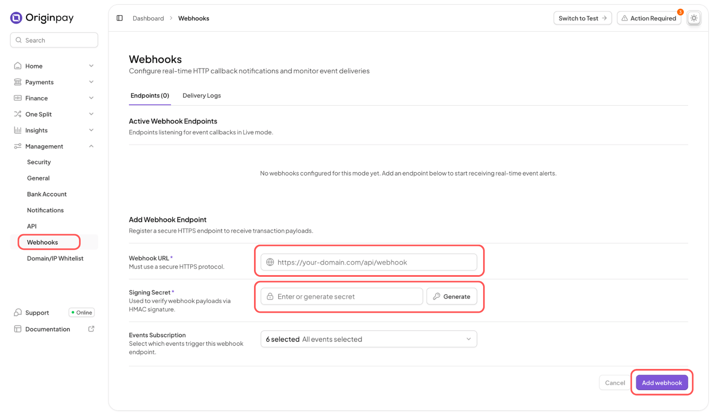

<Tabs>
  <Tab title="Add Webhook">
    Webhooks/Callbacks are a fundamental part of building a robust and reliable payment integration. They provide a powerful way for our system to communicate with your application in real time, ensuring you always have the most up-to-date information about your transactions.

    ## What are Webhooks/Callbacks?

    Webhooks, also known as callbacks, are a mechanism for your server to receive real-time notifications about events from our payment gateway. Think of them as an automated phone call: instead of your server constantly calling us to ask "Is the payment ready yet?", we call your server as soon as a significant event happens, like a successful payment or a refund. This "push" communication model is far more efficient than the traditional "pull" model of polling.

    When you configure a webhook, you provide us with a specific URL on your server. When a payment event occurs, we send an HTTP POST request to that URL. This request contains a JSON/URL encoded payload with all the relevant transaction details, including the status, amount, and unique identifiers. Using webhooks is crucial for updating your database and fulfilling orders, as it guarantees you receive the final and definitive status of a transaction.

    ## Follow below Steps to Add Webhook?

    

    - Login to Merchant Dashboard Panel - [Here](https://merchant.originpay.in)
    - Under the **Management** Menu → Webhooks
    - Webhook direct page link - [Click here](https://merchant.originpay.in/dashboard/settings/webhook)
    - Please enter Webhook URL and Signing Secret (Optional)
    - Select which events trigger this webhook endpoint.
  </Tab>
  <Tab title="Callback">
    Whenever a transaction status changes, Originpay sends an HTTP `POST` request with a JSON payload directly to your configured Webhook URL.

    ## Webhook Request Headers

    Every webhook request from Originpay includes the following HTTP headers:

    | Header | Type | Required | Description |
    | :-- | :-- | :-- | :-- |
    | `Content-Type` | string | Yes | `application/json` |
    | `X-ORIGINPAY-EVENT` | string | Yes | Event name (e.g. `payment.success`, `payment.failed`) |
    | `X-ORIGINPAY-SIGNATURE` | string | Optional | HMAC-SHA256 signature calculated with your Signing Secret |
    | `X-TIMESTAMP` | string | Yes | Unix timestamp in milliseconds when the webhook was generated |

    | Description |
    | :-- |
    | Triggered when a payment attempt issuccessfully authorized and captured. |
    | Triggered when a payment attempt fails, is declined, or expires. |
    | Triggered when a refund request has been processed successfully. |

    |  |
    | :-- |

    | Description |  |
    | :-- | --- |
    |  |  |
    |  |  |
    |  |  |
    |  |  |
    |  |  |
    |  |  |
    | Channel or sub-method (e.g. `UPI_INTENT`, `UPI_QR`, `DEBIT_CARD`) |  |
    | Bank Unique Transaction Reference (UTR / RRN) |  |
    | Bank transaction reference number |  |
    | Customer name returned by the bank or payment method |  |
    | Customer UPI Virtual Payment Address (for UPI payments) |  |
    | Gateway error code (null for successful transactions) |  |
    | Gateway failure description (null for successful transactions) |  |
    | Echo of custom metadata values (`udf1` - `udf5`) sent during order creation |  |
    | ISO timestamp when the order was created |  |

    ## Sample Callback Payloads

    ### Successful Payment (`payment.success`)

    ```json
    {
      "event": "payment.success",
      "event_id": "evt_87a42e09df3c4573ab800000000000",
      "created_at": 1793635890,
      "data": {
        "merchantId": "UPITRANZAC",
        "order_id": "74999361-d7b6-404c-99f0-00000000",
        "merchant_order_id": "TEST8000000",
        "amount": 200,
        "amount_formatted": "2.00",
        "currency": "INR",
        "status": "success",
        "payment_method": "UPI",
        "utr": "219577249161",
        "payer_vpa": "9999999999@upi",
        "paymentDateTime": "2026110221111"
      }
    }
    ```

    ## Signature Verification

    If you configured a **Signing Secret** in your dashboard, every webhook request includes an `X-ORIGINPAY-SIGNATURE` header. Always verify this signature to ensure that incoming requests are genuinely from Originpay.

    ### Verification Formula

    The signature is calculated as an HMAC-SHA256 hex digest of the raw request payload using your Signing Secret:

    $$\text{Signature} = \text{HMAC-SHA256}(\text{rawRequestBody}, \text{signingSecret})$$

    ### Node.js Example

    ```javascript
    const crypto = require("crypto");
    
    function verifyOriginpayWebhook(rawBody, incomingSignature, signingSecret) {
      if (!incomingSignature || !signingSecret) {
        return false;
      }
    
      const computedSignature = crypto
        .createHmac("sha256", signingSecret)
        .update(rawBody)
        .digest("hex");
    
      return crypto.timingSafeEqual(
        Buffer.from(incomingSignature, "utf-8"),
        Buffer.from(computedSignature, "utf-8")
      );
    }
    ```

    ### Express.js Webhook Handler Example

    ```javascript
    const express = require("express");
    const app = express();
    
    app.post(
      "/webhook/originpay",
      express.raw({ type: "application/json" }),
      (req, res) => {
        const rawBody = req.body.toString("utf-8");
        const signature = req.headers["x-originpay-signature"];
        const secret = process.env.ORIGINPAY_SIGNING_SECRET;
    
        const isValid = verifyOriginpayWebhook(rawBody, signature, secret);
        if (!isValid) {
          return res.status(401).json({ error: "Invalid signature" });
        }
    
        const payload = JSON.parse(rawBody);
        const { event, data } = payload;
    
        if (event === "payment.success") {
          const { merchant_order_id, amount, utr } = data;
        }
    
        return res.status(200).json({ status: "success" });
      }
    );
    ```

    ## Merchant Response Requirements

    Your webhook listener endpoint must adhere to the following response criteria:

    - **HTTP Status Code**: Respond with HTTP `200 OK`. Any `3xx`, `4xx`, or `5xx` response status code will be treated as delivery failure.
    - **Response Body**: Return a valid JSON response such as `{ "status": "success" }` or `{ "received": true }`.
    - **Timeout**: Respond within **5 seconds**. Originpay terminates the connection and flags a timeout if no response is received within this window.

    ## 7. Webhook Retry Policy

    If your server is unreachable, times out, or returns a non-200 HTTP response code, Originpay automatically retries the webhook delivery using an exponential backoff schedule:

    | Attempt | Delay After Failure |
    | :-- | :-- |
    | Attempt 1 | Immediate |
    | Attempt 2 | 1 minute |
    | Attempt 3 | 5 minutes |
    | Attempt 4 | 15 minutes |
    | Attempt 5 | 1 hour |

    ## 8. Integration Best Practices

    - **Idempotency**: Always verify whether the transaction or order has already been processed in your database before fulfilling items, as retries or network duplications can deliver the same webhook more than once.
    - **Acknowledge Quickly**: Validate the signature and acknowledge the request with `200 OK` immediately. Offload heavy operations (such as sending emails or third-party CRM syncing) to an asynchronous queue or background worker.
    - **Verify Signature**: Never trust webhook notifications without verifying the `X-ORIGINPAY-SIGNATURE` header when a signing secret is enabled.
    - **Check Fallback Status**: If your endpoint was down for an extended period, reconcile pending transactions by querying the `/v2/order/command` (Status) endpoint.
  </Tab>
</Tabs>
